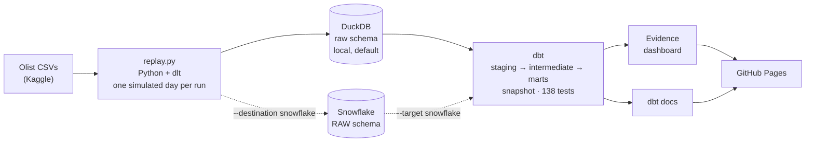
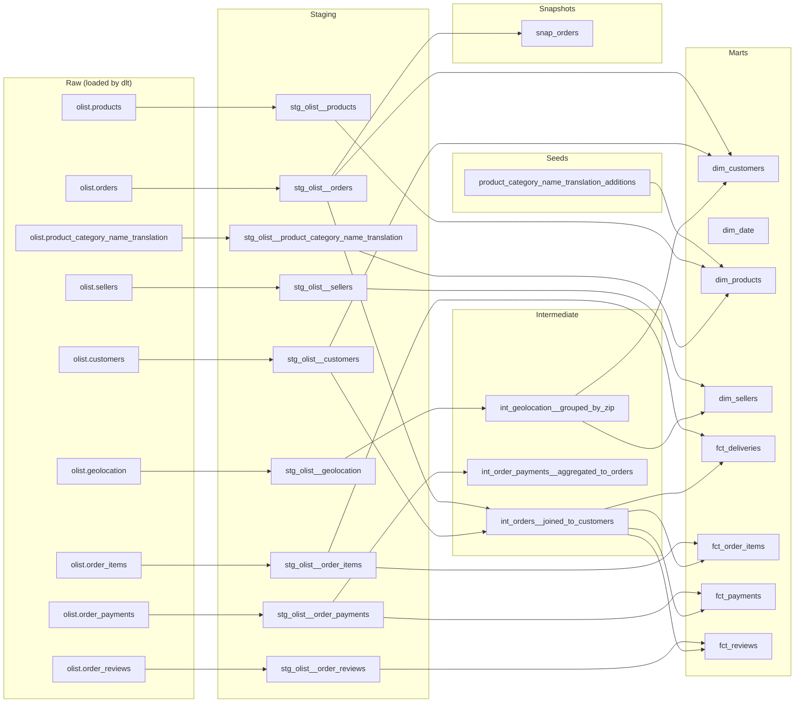

# Olist analytics: an end-to-end analytics engineering project

[](https://github.com/c13mora/olist-analytics/actions/workflows/ci.yml)
[](https://github.com/c13mora/olist-analytics/actions/workflows/deploy.yml)

A static e-commerce dataset turned into a pipeline that behaves like a live
one: replayed day by day with **dlt**, modelled and tested with **dbt**, run on
**DuckDB** and **Snowflake**, and published as an **Evidence** dashboard. Every
design choice is written up in a decision record.

- **Dashboard:** [c13mora.github.io/olist-analytics](https://c13mora.github.io/olist-analytics/):
  executive overview, seller performance, delivery SLAs and customer cohorts.
- **dbt docs:** [c13mora.github.io/olist-analytics/dbt-docs](https://c13mora.github.io/olist-analytics/dbt-docs/):
  every model, column and test, with the lineage graph.

## The problem

The [Olist dataset](https://www.kaggle.com/datasets/olistbr/brazilian-ecommerce)
holds about 100,000 orders from a Brazilian marketplace, 2016 to 2018, as a
one-off export: nine CSVs showing each order's final state. Loaded once, it
never changes, so it cannot show most of what analytics engineering is about:
data that arrives every day, records that change, history that must be kept,
and checks that catch a pipeline going wrong.

This project replays the export **one simulated day at a time**. New orders
arrive, statuses move from created to delivered, and reviews come in. On top
of that it builds the full stack:

- an idempotent loader;
- layered and tested dbt models;
- an incremental fact and a snapshot of status history;
- source freshness checks;
- CI that builds and tests on real data, and a dashboard published only
  when everything passes.

**v1 → v2.** This is the second version of an earlier project,
[olist-dashboard](https://github.com/c13mora/olist-dashboard): a single pandas
script loading DuckDB and a Streamlit app on top. That version answered the
business questions. This one rebuilds them the way a data team would run them
in production: modelling layers with explicit grains, 138 tests, incremental
loads, history, CI/CD, and a second warehouse.

## Architecture



| Layer | Tool | Where |
|---|---|---|
| Ingestion | Python + [dlt](https://dlthub.com), replaying the CSVs as a live source | [`ingestion/`](ingestion/) |
| Warehouse | DuckDB (default, free, local) and Snowflake (secondary target) | [`snowflake/`](snowflake/) |
| Transformation | dbt Core with dbt_utils, dbt-expectations and dbt-project-evaluator | [`dbt/`](dbt/) |
| Dashboard | Evidence, a static site on GitHub Pages | [`dashboard/`](dashboard/) |
| CI/CD | GitHub Actions, SQLFluff and pre-commit | [`.github/workflows/`](.github/workflows/) |

## Data model

Generated from dbt's manifest. The interactive version is the
[lineage graph in the dbt docs](https://c13mora.github.io/olist-analytics/dbt-docs/#!/overview?g_v=1).



| Table | One row per | Notes |
|---|---|---|
| `fct_order_items` | order item | Incremental; picks up new items and status changes. |
| `fct_payments` | payment | Kept apart from items to avoid double counting. |
| `fct_deliveries` | order, every order | Days to deliver, days late against the promise, delivery status. |
| `fct_reviews` | review | Links review scores to delivery performance. |
| `dim_customers` | person (`customer_unique_id`) | Olist issues a new `customer_id` per order. |
| `dim_sellers`, `dim_products`, `dim_date` | seller, product, day | English category names; a date spine. |
| `snap_orders` | version of an order's status | SCD Type 2, dated in business time. |

## Key findings

From the [dashboard](https://c13mora.github.io/olist-analytics/), January 2017
to August 2018:

- **Growth came from acquisition, not loyalty.**
  - Revenue grew from about R$120k a month to R$1.01M in November 2017 (Black
    Friday), for R$13.5M over the period.
  - Only **2.2% of customers ever ordered again** on a later day, and the
    share did not improve as the marketplace grew.
  - 30% of apparent repeat orders were really one basket split into several
    orders on the same day.
- **Late deliveries cost reviews.** The average review falls from 4.32 for
    orders arriving well ahead of the promised date to **1.70** for orders over
    a week late.
- **Promises are padded.** 93% of orders arrive on time, but in a median of 10
  days against 24 promised. On-time delivery fell to 81% in March 2018, and
  the Northeast coast does worst (Alagoas 78.5%).
- **Sellers start the delay.** When a seller hands an order to the carrier
  late, only 79% of deliveries arrive on time, against 95% otherwise.
- **A few sellers carry the marketplace.** The top 10% of sellers earn 67% of
  revenue. 60% of sellers are in São Paulo, and 69% of revenue ships across
  state lines.

## What it demonstrates

| Practice | How | Read more |
|---|---|---|
| A live source from static data | An idempotent replay with merge keys; order status rebuilt from milestone timestamps | [001](docs/decisions/001-replay-loader.md) |
| Layered modelling | Staging (1:1 with sources) → intermediate (joins) → marts, with grains fixed before building | [002](docs/decisions/002-sources-and-staging.md), [003](docs/decisions/003-fact-and-dimension-grains.md), [004](docs/decisions/004-marts.md) |
| Testing | 138 tests: keys, relationships, value ranges, date order, a gap-free date spine, a completeness check on the replay | [004](docs/decisions/004-marts.md) |
| Change over time | An incremental fact (merge on load time) and an SCD Type 2 snapshot, plus a [demo](docs/demo.md) | [005](docs/decisions/005-incremental-and-snapshots.md) |
| Source freshness | Measured from load metadata, not business dates | [002](docs/decisions/002-sources-and-staging.md) |
| CI/CD | Lint, then build and test on real replayed data; best-practice rules enforced; publish only when everything passes | [005](docs/decisions/005-incremental-and-snapshots.md), [006](docs/decisions/006-dashboard.md), [008](docs/decisions/008-polish.md) |
| Cross-warehouse SQL | Identical results on DuckDB and Snowflake; least-privilege roles; the run cost about $1 | [007](docs/decisions/007-snowflake.md) |
| Dashboard as code | Evidence pages whose every query is checked in CI | [006](docs/decisions/006-dashboard.md) |

## Run it locally

Free, on DuckDB. Needs [uv](https://docs.astral.sh/uv/); Node 22 only for the
dashboard.

### 1. Install

```bash
git clone https://github.com/c13mora/olist-analytics.git && cd olist-analytics
uv sync
```

### 2. Download the data

Download the [Olist dataset](https://www.kaggle.com/datasets/olistbr/brazilian-ecommerce)
from Kaggle and unzip it into `data/raw/` (nine CSV files). Or use the Kaggle
CLI with an API token from your Kaggle settings, saved as the only content of
`~/.kaggle/access_token` or set in `KAGGLE_API_TOKEN`:

```bash
uvx --from "kaggle==2.2.5" --with six kaggle datasets download olistbr/brazilian-ecommerce -p data/raw/ --unzip
```

`data/` is gitignored; the CSVs are never committed.

### 3. Replay and build

```bash
uv run python ingestion/replay.py --reset     # reference data + 2016 orders, simulated date 2016-12-31
uv run python ingestion/replay.py --days 90   # load what happened in the next 90 days
cd dbt
uv run dbt deps --profiles-dir .
uv run dbt build --profiles-dir .             # every model, test and the snapshot
uv run dbt source freshness --profiles-dir .
```

The loader and dbt share one DuckDB file, `data/olist.duckdb`. Advance with
`--days 1` and build again to watch the incremental model and the snapshot
pick up changes. `--reset` restarts the simulation, and also drops the
snapshot and incremental fact.

### 4. Watch it change day by day

```bash
uv run python scripts/demo.py --reset --days 7
```

Shows, per day, what the incremental model processed and what the snapshot
recorded, then one order's status history. Walkthrough:
[docs/demo.md](docs/demo.md).

### 5. Preview the dashboard

Replay to the end of the data first (`--days 700`) and build, then:

```bash
cd dashboard
npm ci
npm run sources
npm run dev          # http://localhost:3000/olist-analytics
```

## Running on Snowflake

The same loader and dbt project also run on Snowflake, the secondary target.
On the full dataset, every mart matches the DuckDB build exactly. The run is
documented in [docs/snowflake/](docs/snowflake/), and the reasoning in
[decision record 007](docs/decisions/007-snowflake.md).

### 1. Set up the account (once)

1. **Create a key pair** for the service user (Git Bash includes `openssl`). The
   private key stays on your computer; never commit or share it.
   ```bash
   mkdir -p ~/.snowflake
   openssl genrsa 2048 | openssl pkcs8 -topk8 -inform PEM -out ~/.snowflake/olist_rsa_key.p8 -nocrypt
   openssl rsa -in ~/.snowflake/olist_rsa_key.p8 -pubout -out ~/.snowflake/olist_rsa_key.pub
   ```
2. **Run [`snowflake/setup.sql`](snowflake/setup.sql)** as `ACCOUNTADMIN` in a
   Snowsight worksheet, with `<PUBLIC_KEY>` replaced by the public key on one
   line (`grep -v "PUBLIC KEY" ~/.snowflake/olist_rsa_key.pub | tr -d '\n'`).
   It creates:
   - a `LOADER` role (writes the raw schemas) and a `TRANSFORMER` role (reads
     raw, builds the dbt schemas);
   - an extra-small warehouse, `OLIST_WH`, that suspends after 60 idle
     seconds, capped at 10 credits a month by a resource monitor;
   - the `OLIST` database;
   - an `OLIST_SERVICE` user that signs in with the key, never a password.
3. **Set two environment variables,** then restart your terminal or editor.
   Credentials never go in the repo.
   ```powershell
   [Environment]::SetEnvironmentVariable("SNOWFLAKE_ACCOUNT", "<ORGNAME-ACCOUNTNAME>", "User")
   [Environment]::SetEnvironmentVariable("SNOWFLAKE_PRIVATE_KEY_PATH", "$HOME\.snowflake\olist_rsa_key.p8", "User")
   ```
   Find the identifier with
   `select current_organization_name() || '-' || current_account_name();`.

### 2. Load and build

From the repo root:

```bash
uv run python ingestion/replay.py --reset --destination snowflake     # raw tables, as LOADER
uv run python ingestion/replay.py --days 90 --destination snowflake   # advance the simulation
cd dbt
uv run dbt debug --target snowflake --profiles-dir .   # check the connection
uv run dbt build --target snowflake --profiles-dir .   # every model and test, as TRANSFORMER
uv run dbt source freshness --target snowflake --profiles-dir .
```

The Snowflake replay keeps its own simulated date (`ingestion/state_snowflake.json`),
separate from the local DuckDB one. On Snowflake, `--reset` does not drop the
dbt snapshot and incremental fact, which belong to the `TRANSFORMER` role; drop
the `DBT_DEV_SNAPSHOTS` schema and run dbt with `--full-refresh` after a reset.

### 3. Clean up

To remove everything when you are done, run as `ACCOUNTADMIN`:

```sql
drop database if exists olist;
drop warehouse if exists olist_wh;
drop user if exists olist_service;
drop role if exists loader;
drop role if exists transformer;
drop resource monitor if exists olist_monitor;
```

## CI/CD

Two GitHub Actions workflows run on every pull request into `main`:

- **[`ci.yml`](.github/workflows/ci.yml):**
  - SQLFluff lint.
  - Build on real data: download the CSVs from Kaggle (cached, using the
    `KAGGLE_API_TOKEN` repository secret), replay three months, build and
    test every model, load one more day and build again (exercising the
    incremental model and the snapshot), check source freshness.
  - Enforce dbt-project-evaluator's best-practice rules.
- **[`deploy.yml`](.github/workflows/deploy.yml):** replay the full dataset,
  build and test, generate the dbt docs, build the dashboard and check every
  one of its queries. On `main`, publish both to GitHub Pages.

To run them in a fork, add your own Kaggle API token as the `KAGGLE_API_TOKEN`
secret.

## Decision records

Every non-obvious choice, with the alternatives considered:

1. [Replaying the static dataset as a daily source](docs/decisions/001-replay-loader.md)
2. [Sources, staging and known data issues](docs/decisions/002-sources-and-staging.md)
3. [Grain of the fact and dimension tables](docs/decisions/003-fact-and-dimension-grains.md)
4. [Building and testing the marts](docs/decisions/004-marts.md)
5. [Incremental models, snapshots and CI on replayed data](docs/decisions/005-incremental-and-snapshots.md)
6. [The Evidence dashboard and its publication](docs/decisions/006-dashboard.md)
7. [Running the project on Snowflake](docs/decisions/007-snowflake.md)
8. [Best-practice checks and final polish](docs/decisions/008-polish.md)

The build plan is in [docs/ROADMAP.md](docs/ROADMAP.md).

## Next steps

- **A scheduled daily run.** A daily job that replays one day and builds would
  let source freshness do its real job, alerting when data stops arriving. In
  CI it always runs right after a load.
- **Use the payment rollup.** `int_order_payments__aggregated_to_orders` (one
  row per order) currently only feeds a data quality check; an order-level
  fact could add payment totals beside delivery measures.
- **A semantic layer.** Define revenue, on-time rate and repeat rate once, as
  dbt metrics, instead of in each dashboard query.
- **Faster resets.** Loading the 1M geolocation rows through Python dicts
  takes about 2.5 minutes locally; Arrow-based loading would take seconds.

## Repository layout

```
ingestion/        replay loader (dlt) and simulation state
dbt/              dbt project: models, snapshots, macros, seeds, tests
dashboard/        Evidence dashboard
scripts/          day-by-day demo, dashboard query checker
snowflake/        one-time Snowflake setup (roles, warehouse, service user)
docs/             roadmap, decision records, demo walkthrough, Snowflake run
data/raw/         Olist CSVs (gitignored)
```

## Data and licence

Data: [Brazilian E-Commerce Public Dataset by Olist](https://www.kaggle.com/datasets/olistbr/brazilian-ecommerce),
published by Olist under [CC BY-NC-SA 4.0](https://creativecommons.org/licenses/by-nc-sa/4.0/).
The dashboard's published data is derived from it and shared under the same
licence. The code is under the [MIT licence](LICENSE).
