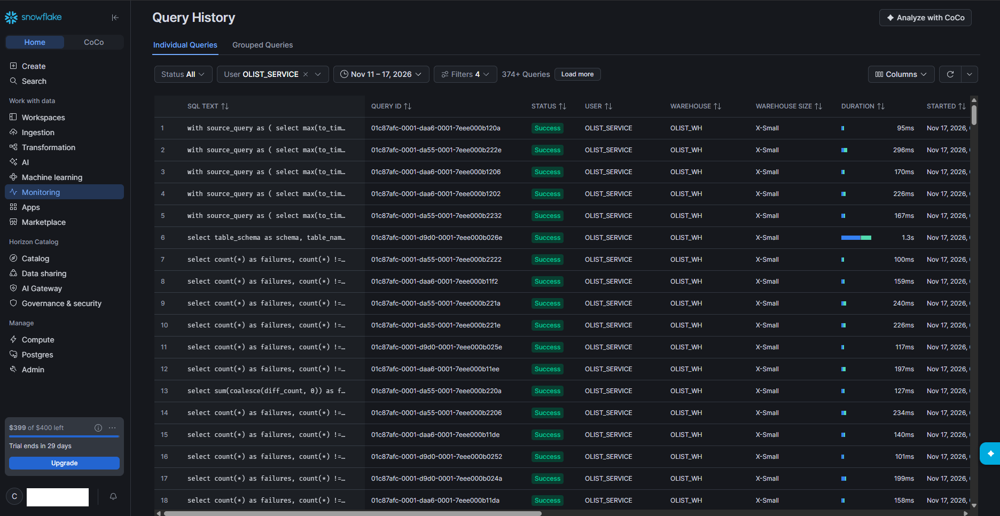
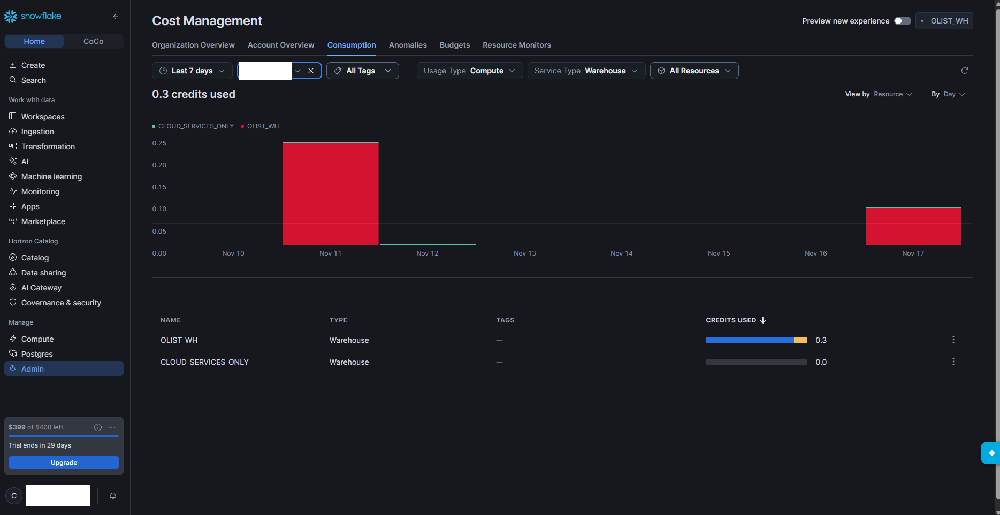

# The Snowflake run

Evidence of running the project on Snowflake, its secondary target, during a
trial account in November 2026. How to reproduce it is in the main
[README](../../README.md#running-on-snowflake); the reasoning is in
[decision record 007](../decisions/007-snowflake.md).

## Results

- **Same results as DuckDB.** With the full dataset loaded in both
  warehouses, every mart and intermediate table matched exactly: row counts,
  revenue to the cent, delivery measures, reviews and coordinates.
- **Every model and test passes:** 152 passes and the one expected warning, the
  same as on DuckDB.
- **It cost about $1.** The whole phase used 0.3 credits on an extra-small
  warehouse that suspends after 60 idle seconds.

## Query history

All queries run by the project's service user, `OLIST_SERVICE`, from the first
load on November 11 to the final build on November 17: dlt's loads (as
`LOADER`) and dbt's models, tests and freshness checks (as `TRANSFORMER`). All
ran on the extra-small `OLIST_WH` warehouse, most in well under a second.

## Cost

0.3 credits in total: about 0.25 on November 11 (setup, the first loads and
builds, and the full-data comparison with DuckDB) and about 0.1 on
November 17 (the final build). The trial balance shows $399 of $400 left.

## Build output

[`dbt-build-output.txt`](dbt-build-output.txt) is the log of the final run,
with the replay loaded to the end of the data:

- `dbt build`: 152 passes and the expected warning.
- `dbt source freshness`: **stale** on all five sources, which is correct. The
  last load was six days earlier, beyond the 48-hour error threshold. Run
  right after a load, the same check passes. That is freshness doing its real
  job, which CI never shows because it always checks right after loading.
